# Game

### Team Name: Tuna Studios

### Game Name: _FishTank!_

### Team Members:

- Alec Currie
- Alex Zhang
- Ben Moore
- Emily Hsu
- Jonathan Chow
- Jun Lee

## How to Play

The game uses tank controls by default, but can be switched to standard WASD in the pause menu (`ESC`) with a toggle. Waves of enemies spawn across multiple levels, and your goal is to make it to the end by defeating all the other mobs!

There are a variety of mobs, obstacles, and bosses that stand between you and victory. Upgrade your fish between levels to better prepare as levels get progressively more difficult, and learn the attack patterns of the bosses.

### Controls:

Movement: (Note that the alternative movements uses standard WASD. Arrow keys are also supported)

- `W` - Moves the player forward in the direction it's facing
- `A` - Turns the player left
- `D` - Turns the player right
- `S` - Moves the player backwards
- `Shift` - Dash (Can ram into enemies), can be used when traveling fast (Cannot be used when stationary)

Combat:

- `1` - Use weapon 1 (Bubble gun)
- `2` - Use weapon 2 (Explosive gun)
- `3` - Use weapon 3 (Mini gun)
- `Left-Click` - Shoots a projectile in the direction of the mouse from the player
- `Right-Click` - Special attack (Burst for bubble gun, mine for explosive gun, magdump for minigun)
- `F` - Deflect incoming enemy bullet towards mouse position

Misc:

- `ESC` - Pause/resume gameplay
- `P` - Toggle FPS counter (performance display)
- `T` - Go to tutorial level
- `K` - Save progress (Useable after tutorial)
- `L` - Load progress

## Gameplay

FishTank! will have players progress through levels consisting of waves of enemies to defeat.
Enemies of different variants spawn in at regular intervals until the level is cleared. Some enemies may be stationary, close-ranged, or even vengeful, but all require slightly different tactics to defeat.

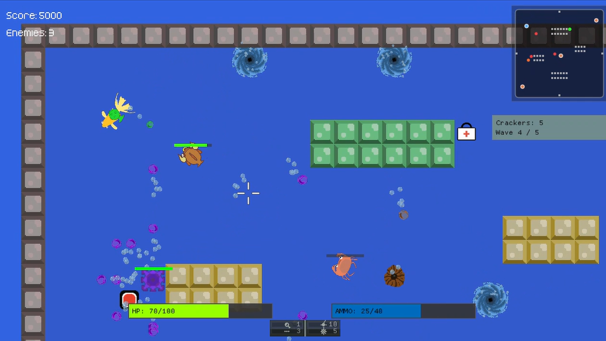

Completing a level will require both attacking enemies and dodging their attacks at the same time. To combat the varying enemy behaviours, they are equipped with different weapons and attack patterns as well. Depending on speed, players may find themselves in a dense field of projectiles to navigate around.

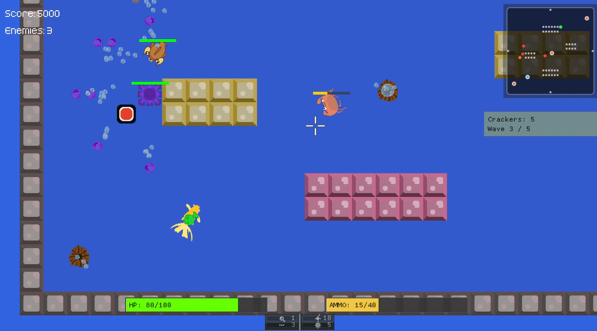

Additionally, players will encounter Boss levels and must use their chosen strategies to surive the phases of attacks and defeat the larger opponent.

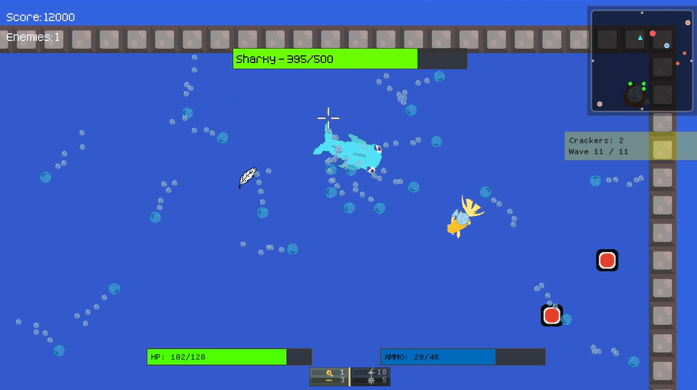

Between levels, players will be given a chance to use their earned currency to upgrade their stats. These upgrades carry throughout the levels and allow players to progress even as the difficulty increases.

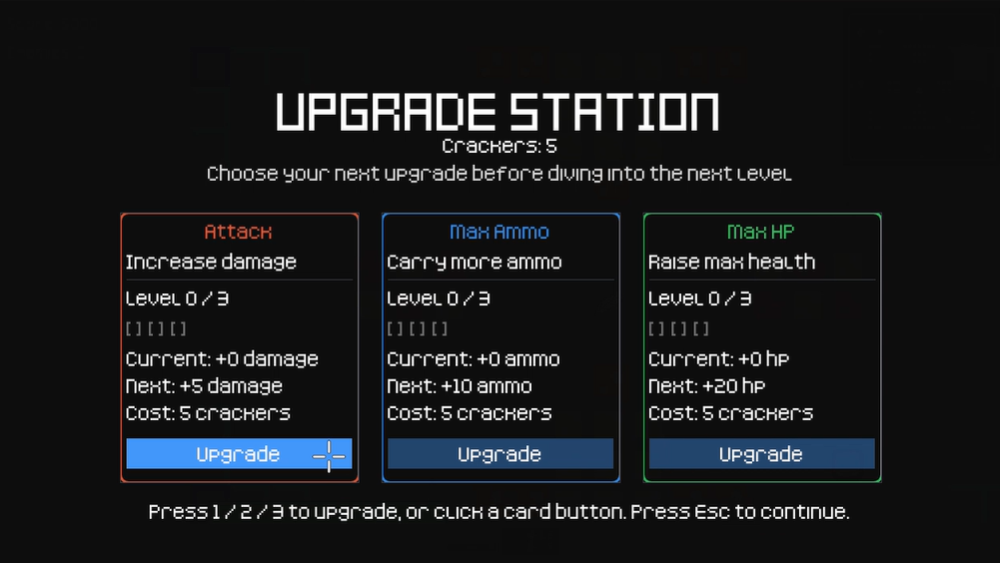

### Game Concept and Setting:

FishTank! is a top-down 2D tank shooter set within a large fish tank. You play as a vengeful goldfish trying to cleanse the tank of the hostile occupiers so that the former inhabitants can return to live in peace.

Each map contains multiple waves of enemies that spawn after each other. Different enemies have different attack patterns, projectiles, and movement. The game loop itself is a mix of bullet-hell and rogue-lite with an upgrade system.

# Milestone 1

### Milestone Goals:

Our primary goal for milestone 1 is to have an initial, closed loop level, to test out our core mechanics of moving and shooting.

#### Movement

Tank controls were imlemented for the player. The controls feature smooth acceleration and deacceleration, and should feel overall fun to use. The quick turnaround feature should also feel like it allows you have flexibility while navigating.

#### Shooting

Shooting is performed by pointing and clicking on the screen. Shooting should feel tense, as the enemy can shoot you if you can shoot them. It should also make the player feel clever, as they can perform bouce trickshots off of walls in order to attack enemies more safely. Our initial prototype has multiple different enemies the player can shoot at.

### Milestone Required Elements:

| Item                          | Implementation               |
| ----------------------------- | ---------------------------- |
| Textured Geometry             | [Here](#textured-geometry)   |
| 2D Transformations            | [Here](#2d-transformations)  |
| Key-frame/state interpolation | [Here](#state-interpolation) |

#### Textured Geometry

Levels for our game are created in TILED, then parsed into TileMap and TileSet objects. The TileMap is a single entity, and is rendered by first checking which tiles are on screen, then rendering those tiles. The TileMap sets the uniforms for the projection matrix, view matrix, tileset size, and tile size.

For each tile, the texture coordinate is processed in the vertex shader to select only the correct tile in the tileset texture atlas. These coordinates are clamped to ensure no texture bleeding occurs when rendering the tiles. Then, in the fragment shader, this texture coordinate is used in combination with a sampler2D to render the tile.

#### 2D Transformations

Multiple 2D transformations are applied during rendering to correctly display entities on screen.

First, a `Transform` matrix is created accordingly to every entity that has a Motion component in the function `RenderSystem::drawTexturedMesh`. Transformations are applied in this order:

`Translate (Motion.position) -> Rotate (Motion.angle) -> Scale (Motion.scale)`

This ensures entities are rendered in their world position, rotation, and graphic scaling as intended.

Next, a projection matrix is created to normalize the the world coordinates based on the size of the window.

Finally, a view matrix offsets the the normalized world coordinates so that entities are rendered in relativity to the camera view, giving the illusion of a moving world.

#### State Interpolation

Smooth camera interpolation is achieved through the use of linear interpolation of the camera's previous position, and the player's position.
The interpolation coefficient is set to 0.03, meaning that for each step the camera moves 3% of the way to the player's position.
Note that the camera does NOT need to increase this percentage. Since the interpolation algorithm runs every frame, the player will
eventually get far enough from the player that the camera will match the player's speed. If the player stops moving, the camera will
get asymptotically closer to the player's position. It's also worth noting that this camera smoothing does not depend on `elapsed_ms`
like many other step functions, becase that would be redundant, as the player position already depends on it.

```C++
camera_pos = camera_pos * (1 - interp_coefficient) + player_pos * interp_coefficient;
```

### Milestone Creative Features:

| Item             | Number | Level | Implementation            | Member |
| ---------------- | ------ | ----- | ------------------------- | ------ |
| Particle systems | [5]    | basic | [Here](#particle-systems) | Alex   |
| Camera controls  | [21]   | basic | [Here](#camera-controls)  | Alex   |

#### Particle Systems

A basic particle system was created the utilizes the VBO to store particle positions for rendering. This system uses a single render call by passing in the VBO and can be parameterized within the particle system settings, which can produce different looking particle effects such as smoke. It is planned to expand this in M2 to do instanced rendering.

#### Camera Controls

A camera view matrix was created in the rendering pipeline to allow the "camera" to follow player movements. The view matrix is created from the position of the camera component that follows the player instead of the player directly, which allows us to interpolate the camera movement and allows natural motion (A subtle "lag") of the camera when the player is moving.

### Milestone Screenshots:

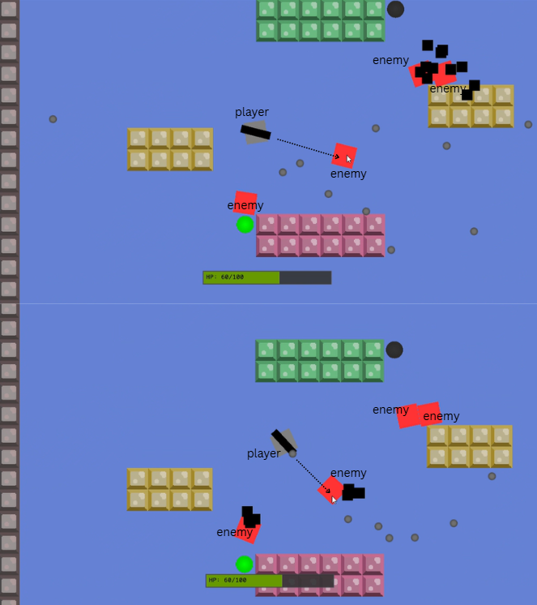

These screenshots showcase the gameplay as of M1. The player character moves according to the controls listed above and a turret is seen to follow the mouse movement. Enemy entities spawn around the map and move toward the player when detected. Players can hide behind the walls to protect themselves or fire projectiles back. When hit, the player takes damage, as seen by the health bar along the bottom.

# Milestone 2

## Milestone Engagement Criteria

We have a tutorial level set up just to give players a snippet of the gameplay. For the main game, we’ve incorporated a level system that changes the map after a certain wave number so that the navigation aspect of gameplay doesn’t get too repetitive. We’ve also set up a wave system which introduces players to different enemy types. There are currently three types of enemies (crabs, isopods, urchins), each with their own unique behaviour and attack pattern.

Additionally, we’ve incorporated an ammunition system, allocating a limited supply of bubbles the player possesses to shoot. To replenish their ammo, players must find and swim towards bubblers.

Perceptually, we’ve added some adorable sprites and animations to make our game come to life (and so that we can distinguish which enemy is which). There’s also visual feedback for when the player or enemy takes/receives damage or healing. Audio-wise, we’ve set up directional audio to let the player know which direction enemies are firing and if there are any nearby hazards (mines).

Finally, we’ve implemented a minimap to inform the player of the location of objects (walls, enemies, hazards, etc.) on the map.

## Milestone Required Elements:

#### Game AI

In this milestone, enemy AIs now have a Sense-Think-Act structure. Each enemy entity is equipped with a Sense component, which stores boolean values for relevant senses like if it can see the player, and an AI component, which stores the state the AI is in following the result of the decision tree. The AI System takes the entity’s current state set in the AI component to execute the correct action.

Currently, all enemies use the same scripted decision tree stored as a .txt file and parsed on creation. Each line in the file corresponds to a node in the tree: its ID, whether it’s a condition or an action, and the IDs of its children. It’s extendable to include a probability property for randomness in the future but for now the enemy’s decision tree is solely conditional.

The tree structure also removes the hardcoding in M1 for action priority. Now, instead of using an if statement to ensure enemies will be properly distracted and stop chasing the player, the decision tree will only direct the enemy to chase if the enemy has not sensed a distraction.

#### Sprite Sheets, Animation, Additional Assets

Sprite sheets are hand-drawn using a mix of Procreate and Aseprite. The animation is handled using the animation system, including the main character and enemies. The animation system is built directly on top of the current rendering system so that no changes are needed for static assets.

In the rendering, there is a check to see if the asset is animated. If it does, it sets an atlas offset and scales the image to use the correct portion of the sprite sheet. The animation system itself simply updates the current sprite index based on the sprite animation duration.

We also have royalty free music & sounds from Pixabay (Jun) which have been integrated through our new audio system.

#### Mesh-Based Collisions

Mesh-Based Collisions use the Separating Axis Theorem (SAT) to perform precise polygon to polygon intersection tests between entities. Each entity with a mesh collider stores a set of local vertices in pixel coordinates, which are transformed to world space using the entity’s position, rotation and scale. The scale is divided by an authoring pixel value to properly convert from the authored pixel size to the actual rendered size. The collision system then handles several specific pair types: bullets are treated as circles and tested against mesh colliders, mesh vs wall collisions convert walls to AABB polygons for SAT testing, and mesh vs mesh collisions test both transformed polygons directly.

The current Mesh-Based Collision implementation is not entirely optimized but this issue is being worked on.

#### FPS Counter

The FPS counter can be toggled with ‘F’ and appears on the top-left corner of the screen. The number shown is simply the average FPS over the last 100 frames.

#### Tutorial

The tutorial level is designed in a way such that the player must navigate around some walls to get familiar with the movement in the game. Then, they are introduced to hazards (mines), health pickups, and ammunition refill bubblers. Lastly, there is a small, non-randomized combat encounter that allows players to get a feel for the combat. Controls are explained through messages, which trigger when the player enters specific parts of the tutorial map.

Should the player wish to return to the tutorial level, they may do so by pressing ‘T’ (tentative feature for M2).

## Milestone Creative Features

| Item               | Number | Level | Implementation              | Member |
| ------------------ | ------ | ----- | --------------------------- | ------ |
| Audio Feedback     | [23]   | basic | [Here](#audio-feedback)     | Jun    |
| Simple Pathfinding | [14]   | basic | [Here](#simple-pathfinding) | Emily  |

#### Audio Feedback

We implemented an audio system integrated into the ECS architecture. A new AudioSystem was created to managed sound effects and background music separately using SDL_mixer.

Directional audio was added for enemy projectiles. The system calculates the relative position between the player and the enemy and dynamically adjusts stereo panning to indicate firing direction.

Additionally, proximity-based hazard warning sounds were implemented. When the player approaches hazards, a looping warning sound increases in intensity based on distance.

Background music support was also added, along with dedicated sound effects for player shots and enemy shots. Volumes are individually tunable to balance gameplay clarity.

#### Simple Pathfinding

Enemy AIs have been equipped with a pathfinding system to be able to navigate around obstacles to reach the player. The first iteration of this pathfinder used BFS as the search algorithm. However, after discovering enemies circling a spot before moving, A\* was implemented instead to provide a more direct pathfinder. Now, enemies are able to find and walk the shortest path to get to the player regardless of the obstacles in the way.

A small modification was made to the pathfinder later when it appeared that enemies knew to walk the shortest path, but would get stuck around corners because of how close the shortest path was to the walls of obstacles. A buffer was added to each point on the path if it laid right next to a wall, letting enemies still walk the shortest path, but keep away from sliding along the wall and trying to cut the corner.

## Milestone Screenshots

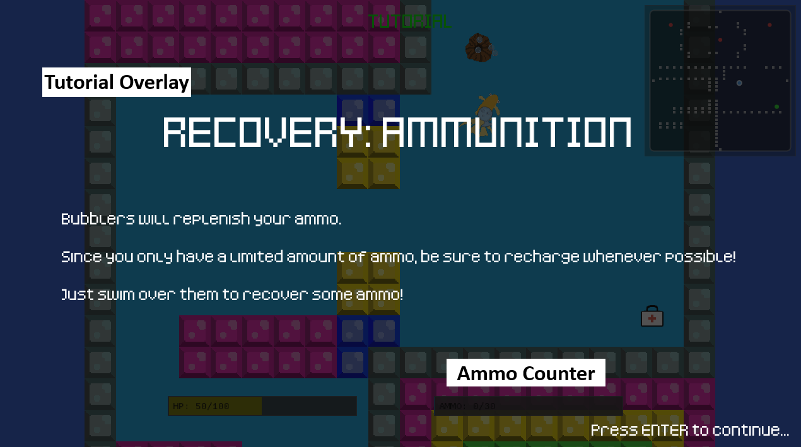

We have implemented some feedback, including adding coloured bullets that make it clear which bullets belong to the enemy. We’ve updated all the entities to have animated sprites. We’ve also added a mini-map to assist in navigation.

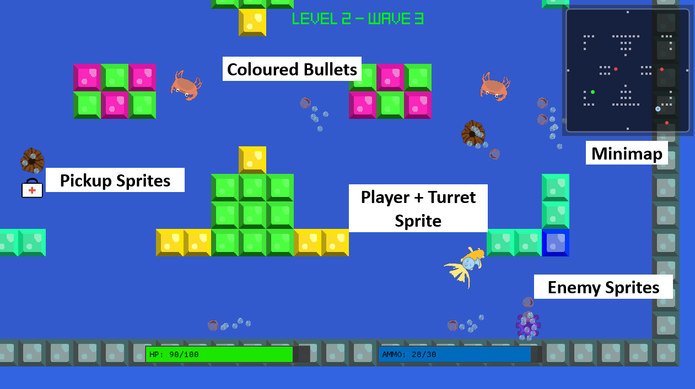

This image shows the tutorial overlay, which teaches the controls and mechanics of the game to new players. In the background, you can see the ammo counter which is one of the new mechanics introduced in M2 and included in the tutorial.

# Milestone 3

## Milestone Engagement Criteria

For M3, we have added several new features and enhancements that help our main engagement methods of combat and upgrades.

Firstly for combat, we've added multiple new enemies including 2 bosses, each with different attack mechanisms.

The player now also has access to 2 different weapons, with each one having 2 attack patterns (left-click, right-click, 4 attacks in total).

- The basic-shot takes up 1 ammo and fires one projectile
- The multi-shot fires a burst of basic rounds
- The explosive-shot takes more ammunition to fire, but fires an explosive round that explodes on contact with another object or at max range.
- The mine-shot also takes more ammunition to fire, but fires a friendly explosive mine. When you shoot the mine with an exploding bullet, the resulting explosion is even larger.

Combined with the various enemies, this gives players a good amount of freedom in their combat decisions and provides good content for gameplay. Demoed below are the 2 new weapons from the explosive gun: (Explosive bullet, friendly mines)

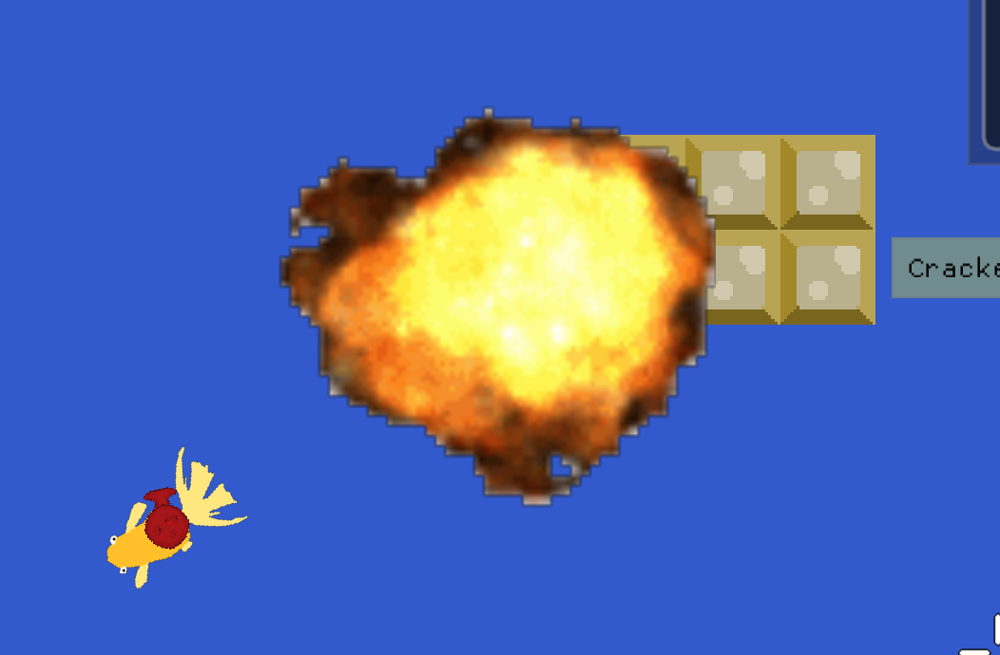

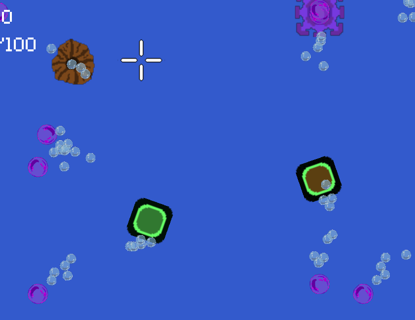

Upgrades are provided through the new upgrade UI, which becomes available at the end of each level. The game rewards the player with usable `Crackers` for purchasing upgrades from defeating enemies. Players can currently choose between 3 different choices: Damage, Ammunition Cap, and Health.

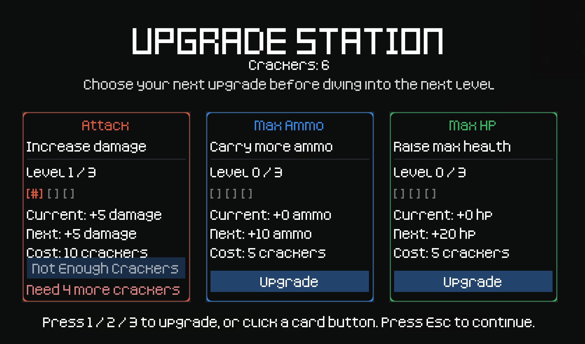

## Milestone Required Elements

### Memory Management

We used the internal tooling for counting total components to ensure there were no left-over components after each run (Press `L`). We used Tracy to track allocated pointers within the program. We also referred to our computer's activity monitor (Mac) and task manager (Windows) for tracking the total memory used by the program.

The total number of components was consistent across the entire game, and we saw no increases after playing the game multiple runs in the same instance. The number of `Active allocations` in Tracy also levelled out at 22000 after completing the game and restarting. However, the memory usage did creep up in Tracy over time by a bit:

<div style="display: grid; grid-template-columns: 1fr 1fr; gap: 10px;">
  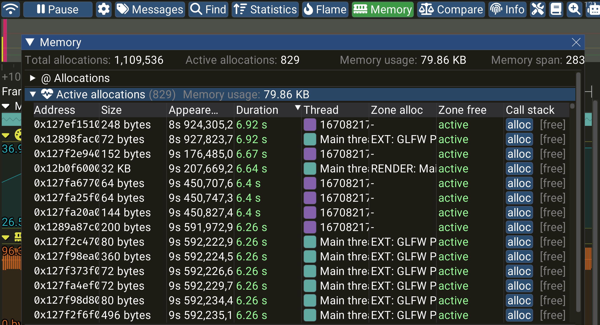
  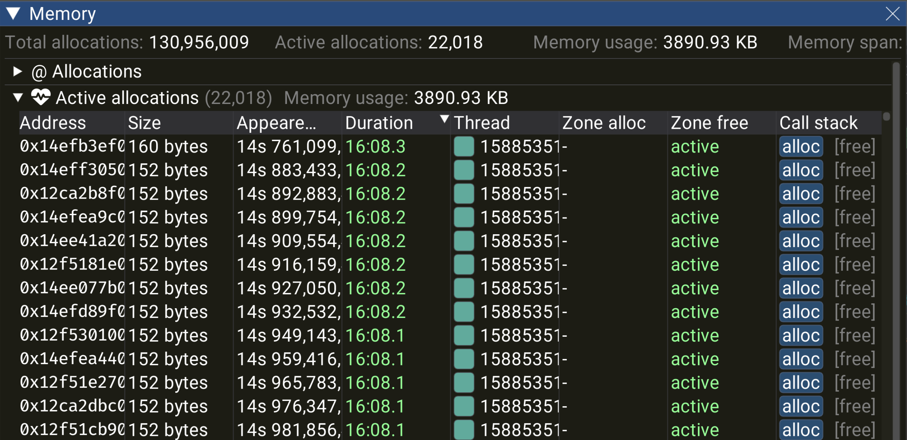
  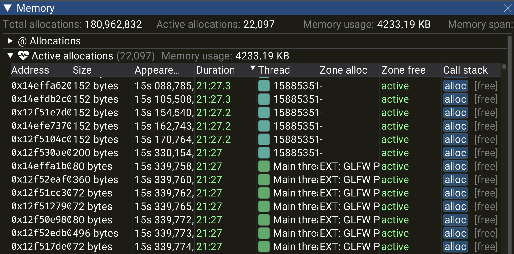
  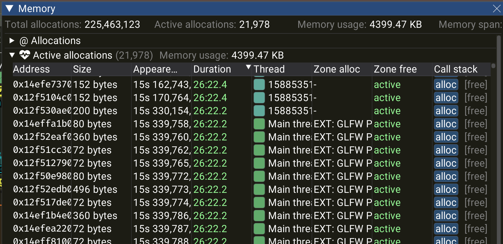
</div><br>

We also noticed that the memory usage in the Activity Monitor increased bit by bit over time during the main game loop. This did not seem to happen when the game is paused, but it gradually increases during the course of the gameplay.

<div style="display: grid; grid-template-columns: 1fr 1fr; gap: 10px;">
  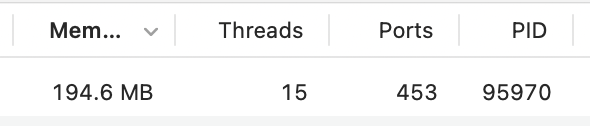
  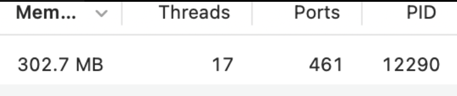
  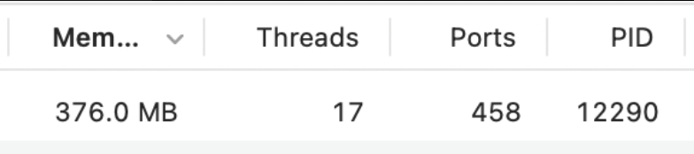
  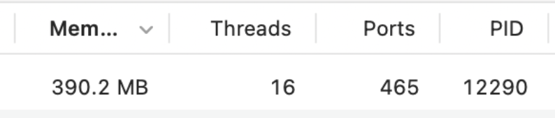
</div>

This is not entirely clear as to where it is coming from, as Tracy and the components list does not indicate any changes. Nor should anything major change when the player and other entities are idle. XCode was used to try and find any hint of a leak, but it did not report any leaks though it did report many allocations.

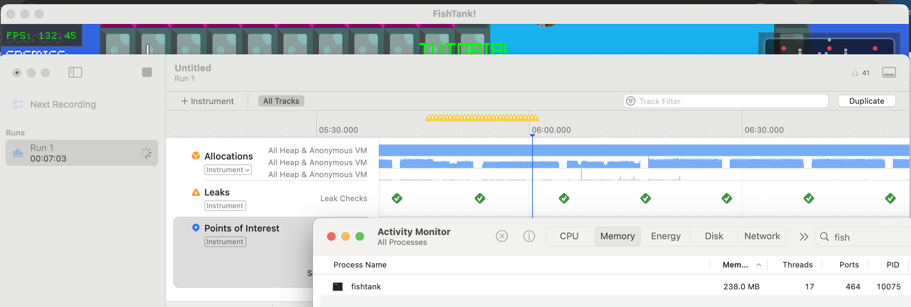

The issue is also not always reproducible, we are working on tracking down where the exact issue is coming from. Individually testing each system will take some time, but will be necessary to find the areas of trouble.

### Realtime Performance

Realtime performance profiling was done through Tracy. We used it to find which systems were the most computationally expensive and target those for refinement. The Collision System and Physics System were both reworked to improve performance.

The main issue was identified as the mesh collision system, which was using a suboptimal separating axis theorem (SAT) method for checking collisions. This would check all the walls for collisions, even those that were far away. Before our rework, the Physics system took up around 45% of the total compute time and Collisions took up another 20%.

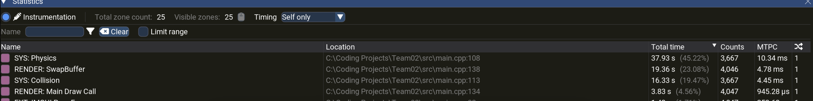

We now use Spatial Hashing in the broad phase to avoid excessive computes, and only use SAT in the narrow phase on nearby entities for collision checking. After the rework, physics only takes up around 5% of the compute time and collisions takes even less than that:

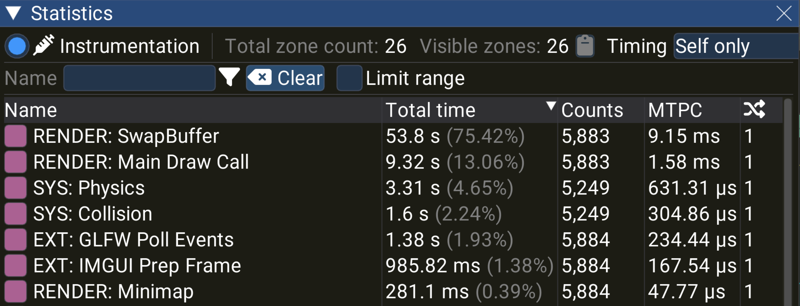

Apart from rendering, which is stable but could be optimized in the future, other systems did not take up a significant amount of time, which helped us focus our optimization on maximum impact.

## Milestone Creative Features

| Item                      | Number | Level    | Implementation                     | Member |
| ------------------------- | ------ | -------- | ---------------------------------- | ------ |
| Complex Prescribed Motion | [9]    | basic    | [Here](#complex-prescribed-motion) | Emily  |
| Swarm Behaviour           | [16]   | advanced | [Here](#swarm-behaviour)           | Emily  |
| Basic Physics             | [8]    | basic    | [Here](#basic-physics)             | Ben    |

#### Complex Prescribed Motion

We used Bezier curves, specifically cubic Bezier curves, to create smooth, non-linear pathing for our enemy variant Mother. This took two parts, 1) generating the control points by map dimensions and 2) evaluating the resulting curve to move the enemy.

A struct was defined called BezierPath to store the control points for a singular curve. Then for every map we initialize, we generate a looped path using four BezierPath elements. Depending on the size of the map and the interior walls, the start and end points are adjusted accordingly to prevent curves from passing through walls.

When Mother enemies are updated in the AI System, the curve is calculated from the control points set and the next position approximated from the fraction of progress, time elapsed, and current speed. To keep the smooth curve intact, instead of letting the Physics system move the entity, position is immediately interpolated and set during curve approximation.

#### Swarm Behaviour

In this milestone, we introduced a swarming enemy variant using BOIDS to simulate a cast of crab children following their mother. Each child uses their mother's position to determine a target, then add on BOIDS forces from their sibling's position.

For a livelier simulation, we adjusted separation higher and coherence lower as to not have the children stacking on each other in narrow spaces as well as produce a natural wandering feel to their movements. Children will still follow Mother and their siblings, but will occasionally branch off when "bored." Eventually, all children will swim back to the group and continue on their way.

#### Basic Physics

## Milestone Screenshots

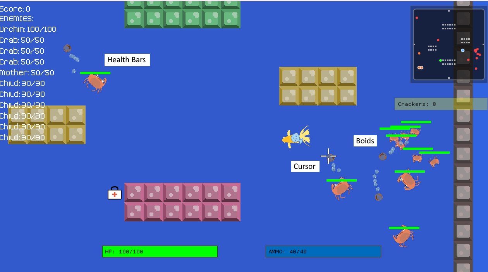

For M3, we've created a new swarming-type enemy, which employs a flocking boids algorithm. Additionally, enemies now have their health displayed above their characters. We've also replaced the default cursor with a custom crosshair one, fitting for our bullet-hell game.

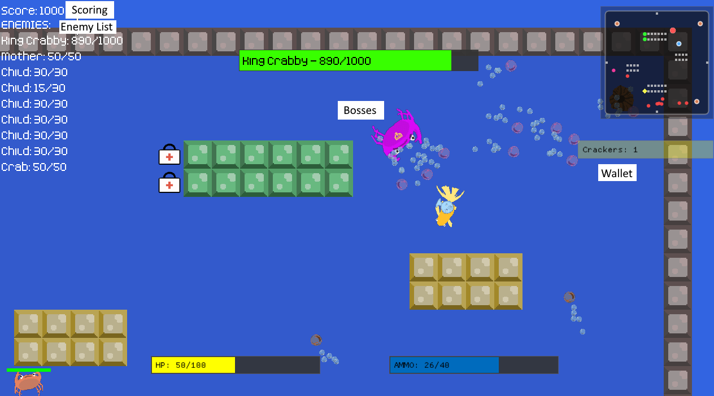

M3 also features a new scoring system that displays the player's current score, a wallet, and a list of enemies that are currently alive. These are useful features for players to keep track of their progress in the game. Bosses were also introduced to provide a little more challenge.

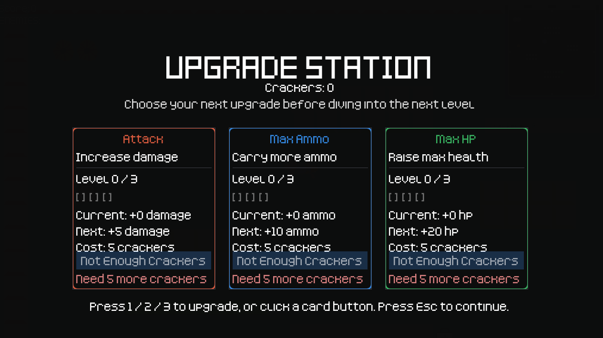

We've introduced an upgrading system, which appears after completing certain waves. For a specified amount of crackers, players can upgrade their fish stats, increasing things like damage, ammo capacity, and max health.

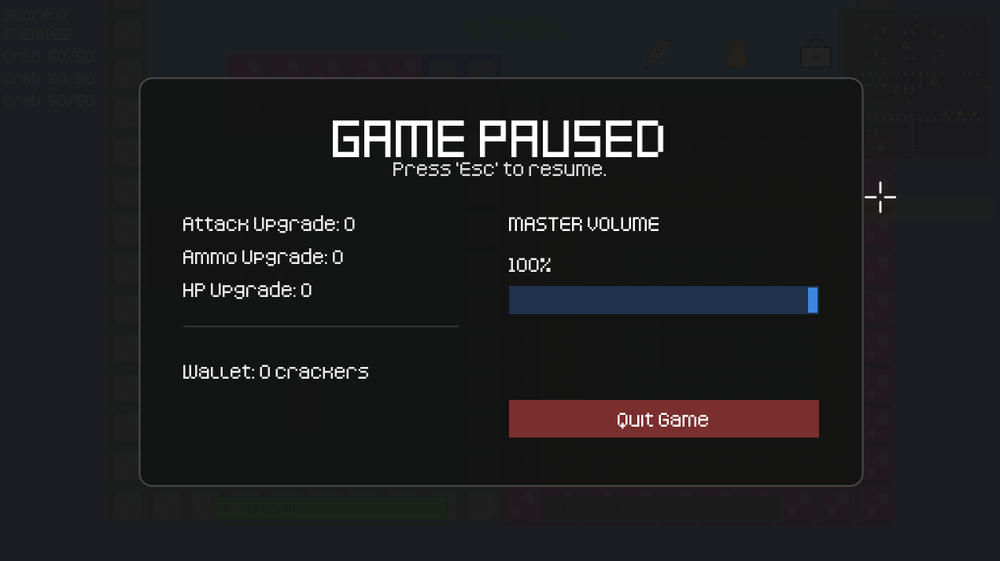

Expanding on M2's implementation, M3 introduces a full and complete pause menu, which allows players to adjust the game volume, quit the game, and view in-game stats like current upgrades and wallet.

# Milestone 4

## Milestone Engagement Criteria

M4 introduces multiple enhancements for combat:

- A melee ramming `bull-fish` enemy
- A new final boss `Eeeel`
- `F` to parry enemy bullets
- `Shift` - Dash (Can ram into enemies), can be used when traveling fast (Cannot be used when stationary)

Numerous gameplay experience enhancements have also been made:

- Sound effects for many more parts of the game
- A continuous tutorial (No pauses interrupting the player)
- An alternative control setting (Pause menu, WASD control toggle)
- Checkpoints upon death (Restart brings you to the start of that level)
- Save and load (`K` to save, `L` to load)

These changes build on top of our previous changes, aiming to engage players via combat and the challenging nature of our game. With everything stacked together, this provides a constant stream of fresh and exciting content for players.

## Milestone Required Elements

### Memory Management

After a lot of extensive tests, it was determined that the previously increased memory usage came from the program storing traces for Tracy itself. The program is already configured to only generate and store traces when tracy is connected using the `TRACY_ON_DEMAND` option in `CMAKE`. This means that the program does not store traces when tracy is not connected, but the problem was that earlier every one of my tests had Tracy connected.

When tracy was not connected, running the game for extended amounts of time on the same level (Same situation as before, stay idle in tutorial while game is running) did not increase the memory usage over time. See below for the example of running the game over 15 minutes:

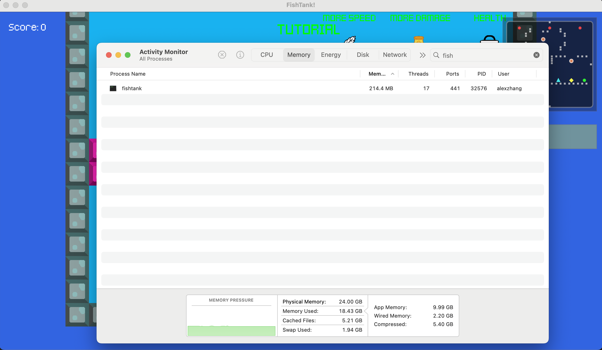
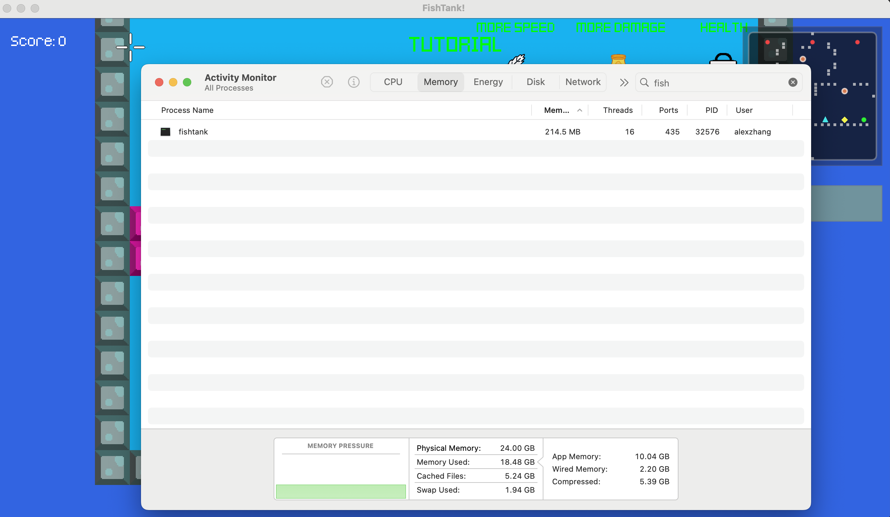

As soon as tracy was connected,m traces started being generated and stored. This caused the memory usage to immediately start building up. See the following image as an example: (First image from a few minutes of running tracy, second image from around 15 minutes of running tracy)

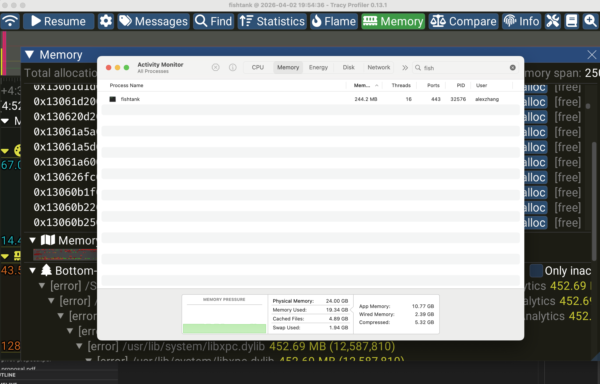
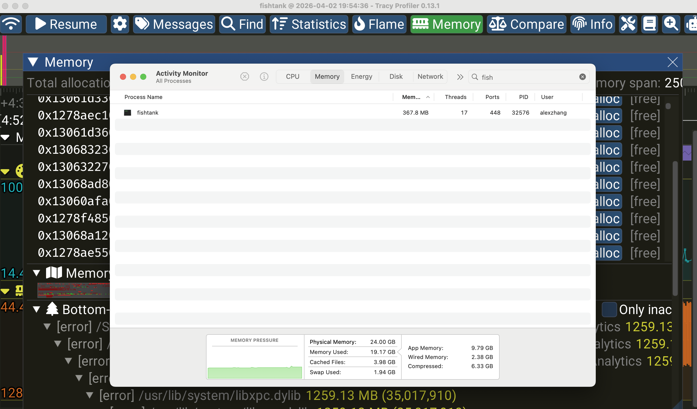

Certain tracy graphs like the memory map seemed to especially increase memory usage, likely due to their granularity. Playing the game normally without tracing will only increase the memory usage up to a certain cap, after which all assets have been loaded and the memory usage no longer increases.

### Realtime Performance

Performance testing was done the same way as M3, where we profiled all systems separately to identify bottlenecks. The physics system especially was monitored throughout development to ensure no regressions happened for the performance.

Below, we ensure that physics system stays at around 5% - 8% and does not regress to its old 30% usage throughout gameplay.

Start of game:

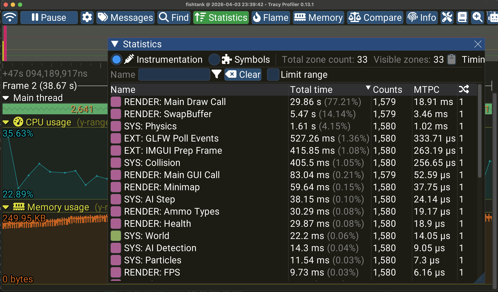

Middle of game:

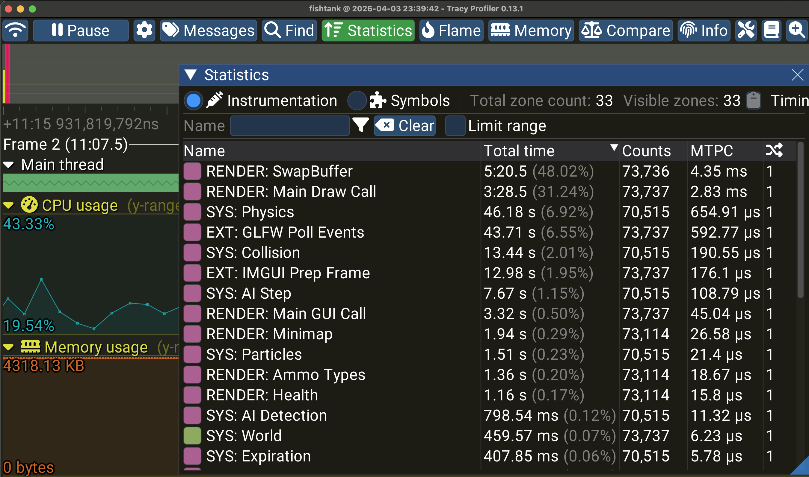

End of game:

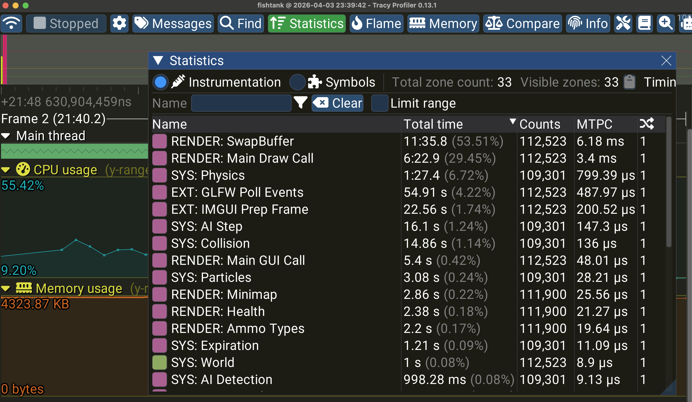

None of the newly introduced system had any significant impact on performance, nor did any of the old systems develop performance issues during development. The FPS remains expectedly stable. (Having lots of projectiles during boss fights and the like is expected to drop the frame rate by a little, but the game still runs in real-time. No noticeable lag)

## Milestone Creative Features

| Item                    | Number | Level | Implementation                   | Member        |
| ----------------------- | ------ | ----- | -------------------------------- | ------------- |
| Reloadability           | [19]   | basic | [Here](#reloadability)           | Alex/Jon      |
| External integration    | [20]   | basic | [Here](#external-integration)    | Jon           |
| Basic integrated assets | [24]   | basic | [Here](#basic-integrated-assets) | Alex/Jun/Alec |

#### Reloadability

The game's progress can be saved up to the most recent level that you've started, excluding the tutorial. This saves your current score, wallet, and upgrades, allowing you to continue from this point after saving and closing the game.

Loading the file reads in the expected level and wave, and utilizes the level loading system to generate the map. Loading the file will also populate the player's statistics and wallet as well as reapply their purchased upgrades.

To save the progress, press `K` on any level after the tutorial. Loading the progress can be done at any point in time by pressing `L`. This will place you back at the start of the level where you saved, while also restoring your upgrades, wallet, and score.

#### External integration

Rather than manually creating UI elements using OpenGL, we opted for a more convenient and efficient solution. Dear ImGui is a GUI library for C++ that provides a simple interface for creating, integrating, and managing UI elements in our game.

A vast majority of the HUD/UI elements were created using ImGui. These include the score UI, pause menu, upgrade menu, minimap, cursor, player health/ammo display, and enemy health bars.

Setting up ImGui is fairly simple. All we needed to do is initialize the ImGui context during startup (and destroy it during shutdown), then incorporate framing and rendering functions into the main game loop. In our design, we created three different class objects to store the logic to render/draw debugging, main game, and tutorial-specific elements. Then all that's left is to call those rendering step functions in the main render loop.

#### Basic integrated assets

We've integrated several custom art assets created via Procreate and Aseprite. These assets are used across several layers of interactions. We also have Royalty free sound assets from Pixabay that have been integrated into the gameplay for map interactions (such as bubblers), bullets, and collisions. Custom art is used for everything including the map tileset, animated player, animated enemies, and particles. The maps also use Tiled to enable us to load levels from the tiled JSON format.

## Milestone Screenshots

To enhance the combat of the game, we introduced a new Boss and a new enemy. The new Boss is the last level of the game, ramping up the difficulty in its attacks for one last challenge to the player. To balance this out, the new enemy is a slightly easier opponent, relying on charging at players instead of firing projectiles.

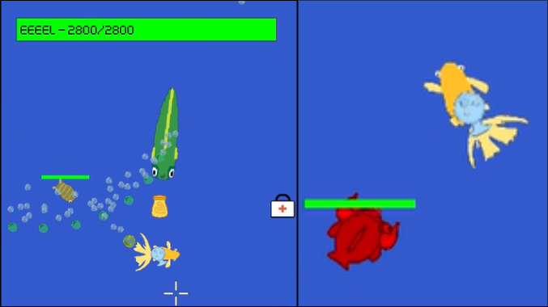

We also took in feedback about the tutorial experience and replaced game pausing text for labels we can place on the map. This allowed players to try the controls without getting stopped by a wall of text.

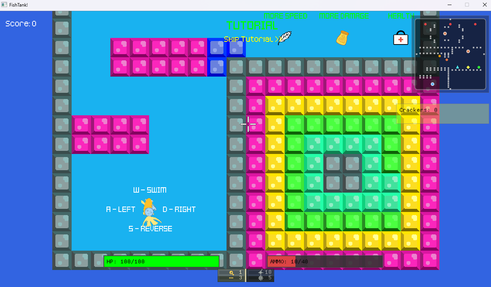

# External Libraries Used

- [RapidJSON](https://rapidjson.org/)
- [ImGui](https://github.com/ocornut/imgui)
- [Tracy](https://github.com/wolfpld/tracy)
